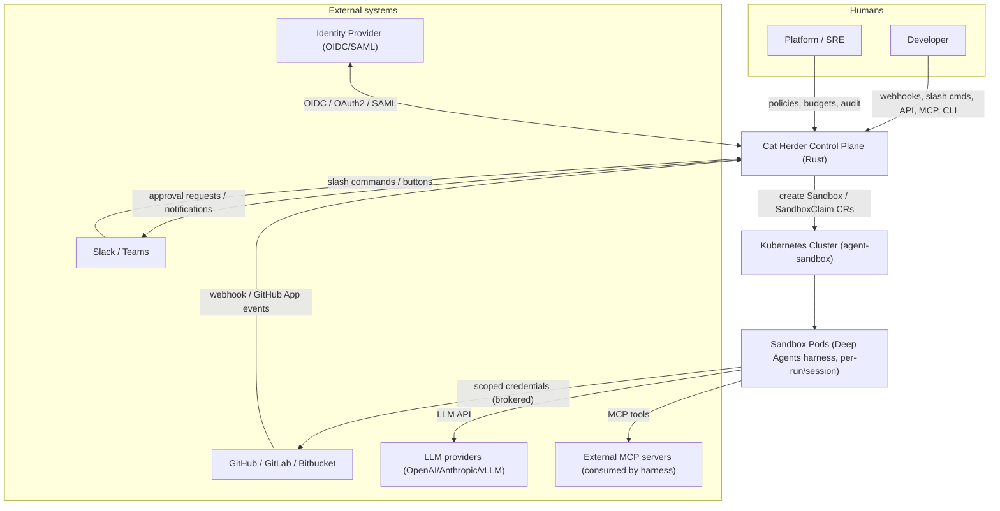
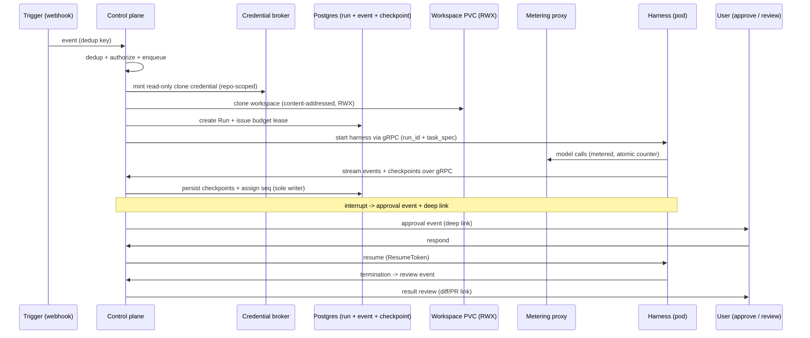
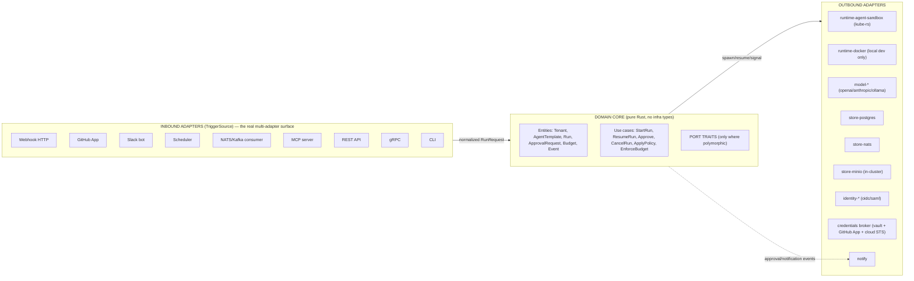
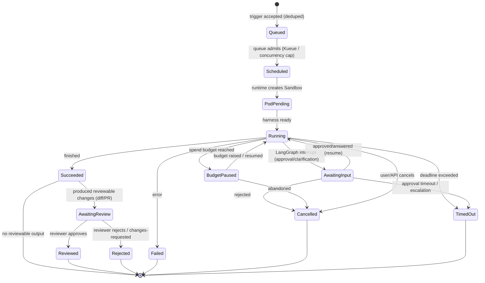
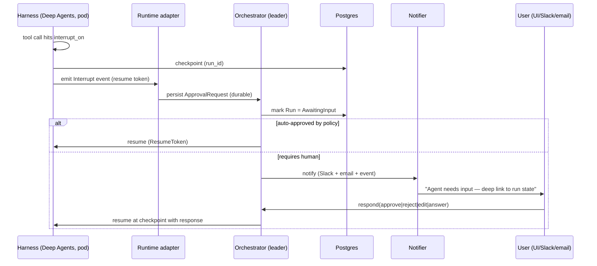
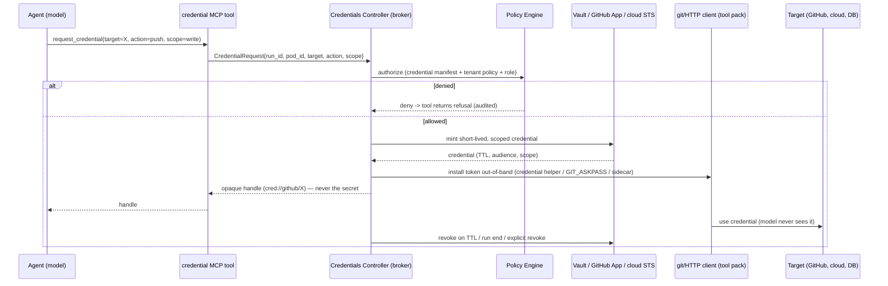
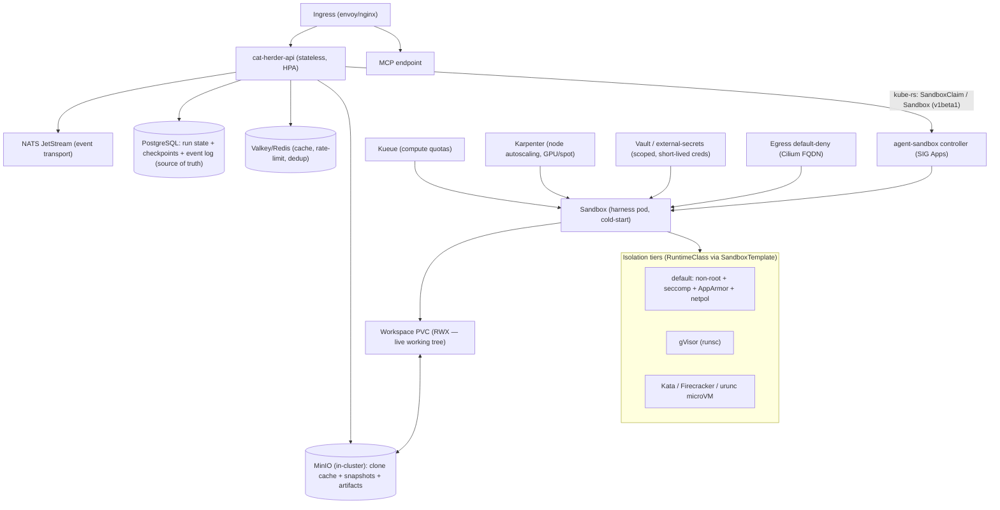

# Cat Herder — Project Plan & Architecture

A self-hosted, Kubernetes-native **control plane and governance layer** for running
AI coding agents. The control plane is **Rust**; the agent "brain" is **Deep Agents on
LangGraph** (Python) running inside sandboxed pods spawned by
**[kubernetes-sigs/agent-sandbox](https://github.com/kubernetes-sigs/agent-sandbox)**.
First-class **MCP**, **SSO + scoped credential brokering**, a **hexagonal
(ports/adapters) core for triggers**, and **human-in-the-loop approvals**.

> Working name: **Cat Herder** (herding autonomous agents = herding cats).

---

## 1. Positioning — what this is, and why it exists

**Cat Herder is not a clone of OpenHands' conversation/Canvas UX.** It answers a
narrower, defensible question:

> How does an organization run, gate, secure, and account for autonomous coding
> agents in production — triggered from many sources, authenticated via SSO, and
> paused for human approval — on its own Kubernetes?

The things OpenHands already does (agent loop, sandbox, webhooks, HITL) are **not**
the differentiators here. The differentiators are:

1. **Rust control plane** — a type-safe, low-footprint API and orchestrator.
2. **Kubernetes-native execution** — agents are first-class sandbox pods via
   agent-sandbox, not Docker-in-a-box.
3. **First-class MCP server** — "run an agent" is a tool any MCP host can call.
4. **Scoped credential brokering, not token passthrough** — agents act on a target
   only through short-lived, sandbox-bound, audience-limited credentials.
5. **Pluggable triggers** — webhook, GitHub App, Slack, cron, MQ, MCP, API, CLI.
6. **Audit, replay, and spend governance** — the *control* half of "agent control
   plane," treated as core, not an afterthought.

**Stack principle:** every component is **open source or self-built** — no proprietary
managed services (no LangGraph Platform, no SaaS). The only ongoing costs are LLM usage
and cluster infrastructure.

The agent **brain is outsourced** (Deep Agents on LangGraph) and extended with a
coding tool pack. That is a means, not the pitch. A full "Canvas"-style UI is
explicitly out of scope for v1 (§21).

---

## 2. What we're building (and how it differs from OpenHands)

| Dimension | OpenHands | Cat Herder |
|---|---|---|
| Product focus | agent UX + agent loop | **control plane + governance** |
| Control-plane language | Python / FastAPI | **Rust (Tokio + Axum)** |
| Agent harness | custom CodeAct (Python) | **Deep Agents (LangChain) on LangGraph** |
| Coding capability | Large Codebase SDK | **coding tool pack (git/PR/diff/test) on the harness** |
| Execution runtime | Docker sandboxes | **kubernetes-sigs/agent-sandbox CRDs** |
| Protocol surface | REST + webhooks | **REST + MCP (server) + gRPC** |
| Auth | API keys / basic | **OIDC/OAuth2 SSO + scoped credential brokering** |
| Extensibility | Python SDK / plugins | **Hexagonal ports & adapters (triggers + runtime)** |
| Triggers | webhooks + automation | **webhook + GitHub App + Slack + cron + MQ + MCP + API + CLI** |
| Human feedback | conversation UI | **LangGraph interrupts + durable approvals** |

**Language split (deliberate, now explicit):** the long-lived control plane is 100%
Rust. The *ephemeral agent harness* is Python (Deep Agents/LangGraph) because that is
where the agent-harness ecosystem lives. The split is justified by *capability*, not
by a preference for rewriting Python. The boundary is a narrow control contract
(§6/§9), and the Rust core never imports or depends on Python.

---

## 3. Goals & non-goals

### Goals
1. **Rust control plane** — performant, type-safe API and orchestrator.
2. **MCP server** — expose "run/list/approve" as MCP tools/resources (stdio +
   Streamable HTTP).
3. **SSO + scoped credential brokering** — OIDC login; agents act on targets only via
   short-lived, sandbox-bound credentials (no raw user-token passthrough).
4. **Kubernetes application** — the *entire* stack runs in-cluster (control plane,
   Postgres, NATS, Redis, MinIO, LiteLLM, broker, agent-sandbox, harness pods) — no
   external managed services; agents are ephemeral, sandboxed pods via agent-sandbox.
5. **Hexagonal where it pays** — pluggable trigger adapters and an execution runtime
   port; concrete deps elsewhere (no ceremony for its own sake).
6. **Human-in-the-loop** — LangGraph interrupts surfaced as durable approvals.
7. **Governance** — spend budgets, trigger hardening, audit, and run replay.
8. **One Helm chart** — the entire stack (control plane + dependencies + agent-sandbox +
   harness) installs with a single `helm install`; all configuration is values-driven.

### Non-goals (v1)
- Training/fine-tuning models.
- Reimplementing agent context management, subagents, or memory — Deep Agents provides
  these (§7).
- A full conversation/Canvas front-end (thin approval dashboard only).
- Codebase-wide indexing/LSP (deferred; §7 notes it as a follow-on).

---

## 4. High-level architecture (system context)



Durable state (run state, event log, LangGraph checkpoints, budgets) lives in the
control plane's stores. Pods are **disposable** — killing one loses only in-flight work
and the pod rootfs; the workspace and durable state survive (§6).

### 4.1 One request, end-to-end

This trace is the contract the rest of the plan must satisfy; it pins down the
hand-offs a box-level view hides.



Hand-offs, resolved:

1. **Who clones private repos** — the **control plane**, using a **read-only,
   clone-scoped credential** minted by the broker at materialization time (distinct from
   the harness's runtime credentials, which don't exist yet). This breaks the
   chicken-and-egg.
2. **How `task_spec` reaches the harness** — in the gRPC start message, alongside
   `run_id`; the trigger's task template (§5) renders it before the run is created.
3. **When the budget lease is issued** — after clone, before the harness starts; clone
   compute is metered separately from the LLM budget.
4. **Checkpoints & events** — the harness streams them over gRPC; the **control plane
   is the sole writer** to Postgres and assigns `seq`. The pod has no DB access.

---

## 5. Architecture — pragmatic ports & adapters

Hexagonal architecture is applied **where there is real polymorphism**, not uniformly.
In Rust terms, a port is a `trait`; adapters implement it and are wired via a
composition root with constructor injection (prefer generics/enum dispatch over
`dyn`-everywhere to avoid `async_trait` boxing and object-safety pain).



### Where ports apply (and where they don't)
- **Triggers** — full port/adapter: each source normalizes into one `RunRequest`.
- **Runtime** — a `AgentRuntime` port with two adapters: `runtime-agent-sandbox`
  (production) and `runtime-docker` (local dev parity only, **not** a production
  fallback).
- **Model provider** — one `ModelProvider` port over vendor clients.
- **Credentials** — a `CredentialBroker` port (request → authorize → mint → revoke)
  with one adapter (§11.3).
- **Stores / identity / notifier** — concrete trait per capability; single adapter
  each is acceptable. We do not invent a second adapter "for symmetry."

Adding a trigger = implement `TriggerSource` + register the adapter. Adding a runtime
= implement `AgentRuntime`. No domain code changes.

### Trigger → RunRequest mapping
A trigger is only useful if an event becomes a *task*. `RunRequest` is the normalized
shape every trigger produces:

```
RunRequest { tenant, source, kind: agent|workflow, task_spec, template/workflow_ref,
             budget, credential_manifest, dedup_key, actor }
```

The mapping from event → `task_spec` is **template-driven**, not hardcoded: a trigger
references a **task template** (a prompt/workflow with placeholders) whose variables
are interpolated from the event payload. Examples:

| Trigger | Maps to |
|---|---|
| GitHub `issue_comment` | template "address this comment" + repo/issue context |
| GitHub `pull_request` | template "review/respond to PR" + diff context |
| Slack slash command | free-text `task_spec` from the message |
| Cron / workflow | predefined workflow definition, no interpolation |
| MCP `run_agent` tool | caller-supplied `task_spec` |

The interpolated payload is **untrusted input**: the rendered `task_spec` marks
event-derived content as untrusted *data* (never trusted instructions), and the harness
wraps it in a boundary the model is told to treat as untrusted (§11.6).

`dedup_key` is the trigger's idempotency key (§11.5); two events with the same key map
to one run.

---

## 6. State model & checkpoint boundary (single source of truth)

This section is the core of the design and resolves the "two brains" problem.

**Rule: the control plane's Postgres is the only authority for lifecycle. The harness
is stateless with respect to durable state.**

- `Run` is the authoritative lifecycle state machine, stored in Postgres.
- **LangGraph checkpoints are persisted to Postgres by the control plane** — the harness
  writes checkpoints/events to a **local, non-authoritative buffer** (pod-local spool)
  and flushes them **asynchronously** over the gRPC control channel; the pod has **no
  direct DB access** (no DB credentials in an untrusted pod). The control plane remains
  the sole authoritative writer and assigns `seq`. Durability boundaries (interrupt,
  terminal) flush **synchronously** before proceeding; a crash loses only the unflushed
  tail.
- The **workspace** (git working tree) lives on a **durable PVC** and is periodically
  **snapshotted** to MinIO (content-addressed, deduplicated), so file edits survive pod
  recreation. The pod's OS rootfs (installed packages, `/tmp`) is **ephemeral** — that
  is the only thing lost on kill/TTL.
- **Resume** = load the checkpoint from Postgres, re-attach the workspace PVC (restore
  from the last snapshot if the volume was lost), re-create the pod, and signal the
  harness to continue from that checkpoint.

```mermaid
sequenceDiagram
    participant O as Orchestrator (leader)
    participant P as Postgres (run + checkpoint)
    participant S as MinIO (clone cache + snapshots)
    participant V as Workspace PVC
    participant R as Runtime adapter (agent-sandbox)
    participant H as Harness (pod)

    O->>P: mark Run = Running
    O->>R: create Sandbox (template + workspace PVC + credential grant)
    R->>V: attach durable workspace
    R->>H: start harness (run_id + task_spec)
    H->>H: buffer checkpoints/events (local spool)
    H->>O: async flush (gRPC); sync flush at interrupt/terminal
    O->>P: persist checkpoints, assign seq (sole writer)
    H->>S: snapshot workspace at quiesced points (interrupt / termination)
    Note over O,P: pod crashes / rolls / TTL (PVC + snapshots survive)
    O->>P: scan non-terminal runs (reconcile)
    alt checkpoint exists
        O->>V: re-attach workspace (restore from snapshot if needed)
        O->>R: recreate pod
        O->>H: resume at checkpoint
    else no checkpoint
        O->>P: mark Failed / retry per policy
    end
```

### Workspace persistence (what "disposable" actually means)
"Disposable" applies to the pod's OS rootfs, not to the agent's state:

| What | Where | Survives pod death? |
|---|---|---|
| Conversation/agent state | Postgres (LangGraph checkpoint) | Yes |
| Working tree (git edits) | durable workspace PVC + MinIO snapshots | Yes |
| Installed packages, `/tmp`, running processes | pod rootfs | **No** (re-provisioned) |

The workspace volume is **ReadWriteMany** (network FS / FUSE CSI), so a replacement pod
attaches without waiting for the old pod to release — resume is non-blocking. Edits go
straight to the live volume, so the PVC is the primary state; **MinIO snapshots** are
taken only at **quiesced points** (on interrupt — the agent is already paused — and on
termination), never mid-`execute`, so snapshots are consistent (no torn state) and
bounded in frequency. Restore-from-snapshot is used only if the volume itself is lost.
The coding tool pack's git operations run against the live volume, so a resumed agent
sees its own edits.

### Reconciliation & crash recovery
- The orchestrator is a **sharded, lease-based reconciler**: reconcile work is
  partitioned by tenant (or `run_id` hash) across N leaders, each owning a shard via a
  lease (Postgres advisory lock or NATS KV). Stateless workers per shard handle pod
  watch and event ingestion, so reconcile throughput scales horizontally instead of
  bottlenecking on one leader.
- The API tier is **stateless** and scales freely; reconcile state is fully derivable
  from Postgres.
- On leader change or crash, the new shard owner scans its non-terminal runs and
  re-attaches watchers / recreates pods as above. Orphans are self-healing.

This also resolves the "durable approval" contradiction: approvals **and** the
checkpoints that resume them are both in Postgres, so neither is lost when a pod dies.

**Resume granularity (honest scope):** LangGraph interrupts at node/tool-call
boundaries, so a long-running `execute` (test suite, `pip install`) cannot be
checkpointed mid-command. On crash mid-`execute`, that command is re-run on resume. The
coding tool pack favors idempotent steps and snapshots the workspace before expensive
or one-shot commands, so re-running is safe.

**No long-lived interactive pods.** A `Session` is a logical grouping of related runs —
conversation continuity is carried by the shared checkpoint + workspace, not by a
persistent pod. There is one disposable pod per run; an interactive client reconnects
to a fresh pod that resumes from the checkpoint.

**Stuck-run detection:** the harness sends a **liveness heartbeat** over the gRPC
control channel; a control-plane watchdog marks a run **Stuck** (and terminates its pod)
if no heartbeat or event arrives within a per-run timeout **while the run is in an
active state** (`Running`, `PodPending`). Runs `AwaitingInput` or `AwaitingReview` are
legitimately idle and are **not** considered stuck — they are governed by approval /
review deadlines instead (§10), not the liveness watchdog. The reconciler watches pods,
but a deadlocked harness looks alive to it — the heartbeat is the actual liveness signal.

---

## 7. Agent harness & workflows (Deep Agents + coding tool pack)

The brain is **[`deepagents`](https://github.com/langchain-ai/deepagents)** (LangChain)
on the **[LangGraph](https://www.langchain.com/langgraph)** runtime, packaged as
`cat-herder-agent-harness` and launched inside each sandbox pod.

### What Deep Agents provides (not reimplemented)
- **Execution environment** — tools + MCP tools, virtual filesystem with pluggable
  backends and declarative read/write permissions, sandboxed `execute` + QuickJS
  interpreter.
- **Context management** — skills (`SKILL.md`), memory (`AGENTS.md`), summarization /
  context offloading, prompt caching.
- **Delegation** — `task` subagents (sync/async, isolated/forked) and `TodoListMiddleware`.
- **Steering** — `interrupt_on` (LangGraph interrupts) wired to our approvals (§10).
- **Durable runtime** — LangGraph checkpointing (external Postgres), streaming,
  fault tolerance.

### Coding tool pack (closes the "not a coding agent" gap)
Deep Agents is a *generic* harness; coding requires a domain layer. v1 ships a coding
tool pack mounted as harness tools:

- git checkout / branch / worktree / commit / push against the **durable workspace**
  (§6), using **out-of-band brokered credentials** (§11.3)
- diff / apply / review (patch artifacts surfaced in the API)
- run tests / lint / build (via sandbox `execute`)
- open/update PRs
- code search (grep/ripgrep over the workspace)

All file mutations happen on the **durable workspace** (§6), never the pod rootfs, so
a resumed agent sees its own edits.

External mutations (branch push, PR open, issue comment) carry an **idempotency key**
derived from `(run_id, action, target)`; on retry/resume the tool reuses or updates the
existing branch/PR instead of duplicating it, so recovery (§6) cannot create duplicate
work products.

**Harness additions (ours, on top of Deep Agents):** a **budget-metering wrapper**
around the model client (enforces the per-run allowance and `max_concurrency` before
each LLM call, §12) and an **out-of-band credential helper** for the coding tool pack
(§11.3).

**Sandbox toolchain image:** the sandbox runs a **separate, versioned toolchain image**
(git, ripgrep, language runtimes, credential helper) layered under the harness. It is
built and scanned in CI (SBOM + vulnerability scan), **pinned per harness version**, and
content-addressed so node-level pulls are cached.

**Codebase-wide indexing / LSP** (the OpenHands "Large Codebase SDK" equivalent) is a
documented follow-on, not v1.

### Run kinds
- `agent` — Deep Agents harness (autonomous).
- `workflow` — a compiled LangGraph `StateGraph` (deterministic topology, can mix
  deterministic + agentic nodes).

Both checkpoint to the same external Postgres via the control plane (§6), so
pause/resume, retries, and HITL work identically.

### Harness control surface (self-built, OSS only)
We **embed OSS LangGraph** in our own `agent-harness` server — there is no
managed/proprietary LangGraph Platform or Server. The control surface
(start/pause/resume/cancel, event + checkpoint streaming, heartbeat) is a thin gRPC
wrapper we build over the OSS `langgraph`/`deepagents` libraries.

### Memory & skills (central repository, OKF)
`AGENTS.md` memory (preferences) and skills live in a **central, versioned repository**
reachable through the control plane — not pod-local — so "improve over time" is durable
across disposable pods and shared per tenant. **Skills and commands are packaged in the
Open Knowledge Format (OKF)** — Google's open spec for portable, agent-friendly
knowledge (Markdown + YAML frontmatter: provenance, trust, lifecycle, staleness) —
rather than ad-hoc prompt files. The OKF knowledge base is the versioned source of
truth; a **Postgres + pgvector** index (or a LangGraph Store backend) makes it
searchable and holds per-tenant memory state. The knowledge base has a **trust
boundary**: writes are gated (approved authors, reviewed before promotion), OKF
provenance/trust/verification frontmatter is **enforced** (unverified or stale skills
are not loaded, or are flagged), and tenants pin skill versions — a poisoned skill is a
tenant-wide injection, so the knowledge repo is a protected, audited surface, not a
free-form wiki.

---

## 8. Run lifecycle & budget state



Every transition is a domain event (§9) and is reconciled by the leader (§6). Result
review (§10) is a first-class lifecycle stage: a run producing a diff/PR enters
`AwaitingReview`; rejection or change requests terminate the run (a follow-up is a new
`Run`, linked by the review event).

---

## 9. Event contract (single event log, two projections)

The event log is the connective tissue of the system. There is **one canonical,
append-only event store**, not two competing models.

**Canonical envelope (versioned):**
```
{ run_id, seq, type, schema_version, timestamp, actor, payload }
```

Two projections read from this one store:

1. **Lifecycle projection** — control-plane transitions (`run.queued`,
   `run.scheduled`, `run.running`, `approval.requested`, `budget.exceeded`, …).
2. **Agent projection** — LangGraph typed events (messages, tool calls, subagent
   handles, checkpoints) normalized into the envelope as `payload` types.

- The harness **buffers raw LangGraph events locally and flushes asynchronously** over
  gRPC; the **control plane normalizes them into the canonical envelope and appends with
  a monotonic per-run `seq`** — the sole writer, so no multi-producer ordering problem.
  Interrupt and terminal events flush **synchronously**, so durability boundaries are
  exact while the hot path stays decoupled (a crash loses only the unflushed tail). The
  REST `GET /runs/{id}/events` stream serves this one coherent timeline;
  `stream.subagents` is a projection over it, not a separate model.
- Correlation: every pod log and OTel trace carries `run_id` (§16).
- The event log is the source of truth for **replay** and **cost attribution**.

**Storage decision:** **Postgres is the durable source of truth** for the event log
(append-only, replayable). **NATS JetStream is the transport** — pub/sub fan-out and a
short-lived buffer — not the authority. Replay (§16) reads Postgres.

### Contract versioning (harness ↔ control plane)
- The event envelope carries `schema_version`; the harness control surface (gRPC proto)
  is versioned independently and **backward-compatibly**.
- Harness images are tagged with the control-plane API range they support; the control
  plane declares its supported harness range and **refuses to launch** an incompatible
  harness image.
- This yields a two-artifact **version-compatibility matrix** (Rust core ↔ Python
  harness) instead of silent drift.

---

## 10. Human-in-the-loop (durable approvals via LangGraph interrupts)



- The resume handle is an opaque domain `ResumeToken` (the LangGraph checkpoint key),
  not a framework type leaking into the domain (§15).
- Approvals carry timeouts + escalation ("no reply in 15m → notify manager; 1h →
  auto-reject"), and both the approval and its checkpoint survive pod loss (§6).

**Approval surface (v1, minimal):** an approval is an **event** carrying a **deep link**
to the run's state (the interrupt checkpoint, the pending tool call, and the workspace
diff). For now there is no bespoke review UI — the link opens a read-only run view (to
be built later); responses arrive via API/Slack/email. **Known limitation:** until the
read-only view ships, a v1 approver approves without seeing the diff — the "governance"
guarantee is **deferred, not delivered**, in v1. A minimal read-only diff view is the
first follow-on (§20).

### Result review (code-review loop)
A run that produces code changes emits a **review event** at termination, carrying the
produced diff/PR and a deep link to the run view. A **review queue** (runs with
unverified changes) is exposed via API/MCP; a reviewer marks `approved` / `rejected` /
`changes-requested`. `AwaitingReview` carries a **deadline + escalation** (no review in
N → notify; in M → auto-approve or auto-reject per policy). Rejection or change
requests feed back as a **new run**: the reviewer's decision + comments are injected as
the new run's `task_spec` (a review-feedback template, §5), linked by the review event —
closing the loop with explicit plumbing, not just prose. This is a specialized approval
on the run's *result* (not a tool call) and, like tool approvals, is v1-minimal: an
event + link + an outcome endpoint — the rich review UI is a follow-on.

---

## 11. Security model (SSO, credentials, isolation, triggers)

### 11.1 Threat model
**Assumption: agent code is untrusted and will, at some point, attempt to exfiltrate
credentials.** Design is least-privilege-by-default.

### 11.2 SSO
- OIDC/OAuth2 Authorization Code + PKCE (Keycloak, Okta, Auth0, Azure Entra, Google,
  GitHub); SAML 2.0 via adapter where required.
- The control plane issues short-lived session JWTs to clients only.
- **Directory sync & provisioning**: SCIM 2.0 for user/group provisioning from the IdP;
  groups map to tenant roles/policies, so an SSO user lands in the right tenant with the
  right permissions without manual role assignment.

### 11.3 Credential brokering — a JIT credentials controller

There is **no direct user-token injection and no credentials baked into the pod at
start.** Instead, a **credentials controller** implements the `CredentialBroker` port
(§5) and hands out *specific, scoped, short-lived* credentials **just-in-time** —
only when the agent actually needs one, for a declared `target`, `action`, and
`scope`.



**Flow:** request → authenticate (which run/pod) → authorize (policy-gated, **not**
user-declared) → mint → **deliver out-of-band to the client, never to the model** →
return an opaque handle → revoke. Every request/mint/revoke is an audited event (§9).

> **Rule: the secret never reaches the model.** The `credential` tool returns an opaque
> handle (`cred://github/X`); the actual token is materialized into the coding tool
> pack's git/HTTP client via a credential helper (`GIT_ASKPASS`), a sidecar, or a
> non-env secret mount — out of the model's context, checkpoints, and traces. This is
> what makes "never logged" actually true.

**Per-target credential types:**

| Target | Credential | True "sandbox-bound"? |
|---|---|---|
| AWS / GCP / Azure | STS / workload-identity token | Yes — bound to the pod ServiceAccount |
| GitHub / GitLab | App installation token (scoped to the App's install + permissions, ~1h TTL, revocable) — *not* the user's OAuth token | No (bearer) — scope = per-tenant App with minimal permissions, + TTL + revoke + egress deny |
| Database / internal API | short-lived dynamic secret from Vault | Yes — Vault binds to pod identity |
| Kubernetes API | projected, expiring bound ServiceAccount token | Yes |

**Defense-in-depth for git hosts:** a GitHub App installation token cannot be bound to
a pod, so the mitigation is *scope + TTL + revocation + egress default-deny (§11.4) +
audit* — a stolen token is narrow, short-lived, and can't be exfiltrated because the
pod can't reach arbitrary endpoints. This survives both "untrusted code" and
"untrusted instructions" (§11.1).

**Scope granularity (honest):** an installation token is scoped to *the App's install
and permission set*, not per-repo/per-action. Scope is therefore enforced by using a
**separate, minimal-permission App per tenant (or per repo set)**; the broker selects
the App from the requested target and tenant. Where finer per-repo control is needed,
use short-lived fine-grained PATs or narrowly-scoped OAuth tokens instead.

**Caching & availability:** minted credentials are cached keyed by `(run_id, target)`
for their TTL, so repeated operations on the same target short-circuit. The broker is a
**stateless, horizontally-scaled service** (minting is stateless given the vault/App),
so availability comes from replicas, not one process. The git/HTTP client's credential
helper also holds the materialized credential in memory for its TTL, so the model's
repeated `credential` calls just return the cached handle.

**Tenant isolation (credentials):** the broker enforces a **tenant boundary** — a run
may only request targets within its tenant's manifest and its tenant-scoped providers
(per-tenant vault namespace, per-tenant GitHub App, per-tenant cloud role). A
cross-tenant mint request is refused and audited. (§11.4 covers pod networking; this
covers credential minting.)

**Approval-gating:** targets/actions *inside* the run's pre-approved manifest mint
automatically. A request for a **new or escalated target** triggers an ApprovalRequest
via the HITL flow (§10) before the credential is issued.

**Clone-scoped credentials (workspace materialization):** before the harness exists, the
**control plane** mints a separate **read-only credential scoped to the task's declared
repo set** (validated against tenant policy — not "any repo in the tenant") from the
broker to check out the workspace (§4.1). Multi-repo tasks declare the full set; any
repo the agent wants *beyond* that set goes through the normal, approval-gated runtime
credential flow (§10). The credential is read-only and revoked once the clone completes.

**Agent-facing channel:** for git/PR, credential acquisition is **implicit** — the tool
declares its `target` and requests the credential itself via the sidecar, so the model
never coordinates "request then push." For non-git targets, the model may call
`credential(target, action, scope)` and receive an **opaque handle** — never the secret
(§14). In both cases the secret is injected out-of-band into the client (above), and a
target mismatch is **refused** rather than silently misused. A local sidecar
unix-socket is the fallback for non-MCP harnesses.

**Optional hardening:** **SPIFFE/SPIRE** pod identity (SVIDs) gives the broker a
verifiable *which pod is asking* proof, strengthening cloud/Vault/mTLS binding.

**Broker hardening (the broker is itself a high-value target):** the broker runs as a
**separate service** with a narrow ServiceAccount and **no ambient cloud credentials**.
Its own secrets (per-tenant GitHub App private keys, per-tenant Vault access,
per-tenant cloud STS roles) live in a secrets manager, are **rotated**, and are
**tenant-scoped** — so a broker compromise is bounded to a tenant, not global. Callers
are authenticated by **mTLS / SPIFFE SVID** (the harness sidecar's pod identity or the
control plane's workload identity); the broker resolves `run_id` from the caller's
verified identity + a control-plane-signed run token, so a forged `run_id` string mints
nothing. Authorization is enforced per request (policy engine, §20 Phase 1).

### 11.4 Network isolation & egress
- **Egress default-deny** (Cilium FQDN / NetworkPolicy); the pod can reach only
  approved endpoints (LLM provider, declared MCP servers, declared git host).
- **Tenant isolation**: namespace-per-tenant with NetworkPolicy + resource quotas by
  default; **vCluster** for hard isolation (separate API surface). Isolation is a
  first-class, day-one design, not a footnote.

### 11.5 Trigger hardening (anti-fan-out)
- **Signature verification** per source (webhook HMAC; GitHub App JWT + installation
  tokens; Slack signing secret), secrets stored in vault and rotated.
- **Idempotency & dedup**: webhook delivery IDs / idempotency keys; replay cache of
  seen event IDs.
- **Admission & cooldown**: per-source rate limiting and per-tenant **concurrency
  caps** on spawned runs.
- **Service-to-service**: mTLS (cert-manager) + workload identity (IRSA / Entra / GKE).

### 11.6 Prompt injection & untrusted input
Untrusted content (repo files, issue/PR bodies, Slack messages) is treated as
potentially hostile instructions. **None of these defenses is a guarantee** — LLMs do
not reliably honor instruction hierarchies under adversarial input — so they are
defense-in-depth *mitigations*, with scoped credentials (§11.3), egress default-deny
(§11.4), and approval gating (§10) as the actual backstops.

- **Secrets never reach the model** — out-of-band credentials (§11.3) and no secrets in
  env/context/tool output, so an injected "read `/run/secrets`" finds nothing.
- **Instruction hierarchy (best-effort)** — the harness system prompt outranks retrieved
  content, but this is a probabilistic mitigation, not a guarantee; treat it as one
  layer among several.
- **Tool-call allowlisting + approval gating** — the agent can only invoke tools in its
  declared set; high-risk actions (push, credential escalation, prod access) require
  approval (§10).
- **Read-only-by-default filesystem** — permissions default-deny sensitive paths (§7).
- **Egress default-deny** — an injected "POST to evil.example" fails at the network
  layer (§11.4).
- **`task_spec` is an injection surface** — trigger payloads are interpolated into the
  task (§5), so the rendered task marks event-derived content as untrusted data, never
  trusted instructions; the task template must not let payload text override the system
  prompt or tool allowlist.
- **Audit + replay** — every tool call is an event (§9), so injection attempts are
  visible and replayable (§16).

### 11.7 Retention, deletion & compliance
The control plane stores code (workspace snapshots), full agent conversations (event
log + checkpoints), LLM traces, and credential metadata — so retention/deletion is a
day-one concern, not a Phase-5 garnish. Policy: configurable retention per tenant; a
deletion API purges a run's events, checkpoints, snapshots, and artifacts (hard
delete); no secrets in the event log by construction (§11.3); access/audit logs for the
governance buyer.

### 11.8 Authorization model
- **Decision points**: run creation (may this user/tenant start a run?); tool invocation
  (may this run call this tool?); credential minting (may this run request this
  target/scope?); approval (who may approve what?); result review (who may mark a result
  approved?).
- **Model**: RBAC for coarse roles (viewer/operator/admin per tenant) + attribute-based
  rules for fine-grained policy (e.g., "push to `main` requires approval"; "prod-scoped
  credentials require a second approver").
- **Language**: v1 uses a small declarative policy DSL over the §15 domain entities;
  OPA/Cedar is the Phase-3 upgrade to a full engine (§20), not the v1 requirement.

---

## 12. Cost & spend governance

Autonomous agents are token-burning machines; spend control is core, not optional.

**Enforcement point — where the "hard stop" actually lives.** The orchestrator is not in
the LLM call path, so it cannot hard-stop a call after the fact. Enforcement is layered,
with the authority in the path, not in the harness:

1. **Metering proxy (the hard stop, mandatory) — LiteLLM (OSS).** All model traffic
   flows through the gateway in front of the provider. It meters tokens against a
   **central atomic counter** (Redis `INCRBY`/`DECRBY`) keyed by `run_id`, and **rejects
   any call that would exceed the cap before it reaches the model.** This is the
   authoritative enforcement point and cannot be bypassed by the harness or the agent.
   For self-hosted vLLM/Ollama the same proxy meters token usage (GPU-time accounted
   separately, §16). Enforcement is **physical**: the pod's egress allowlist (§11.4)
   permits only the proxy for model traffic — the raw provider endpoint is not reachable
   from the pod, so a bypass (a tool or MCP server with its own model access) is blocked
   at the network layer, not just by convention. **Security:** LiteLLM is pinned, scanned
   (SBOM + vuln), and CVE-tracked — it has a history of SSRF and access-control CVEs, so
   it is a hardened, version-pinned edge component, not set-and-forget.
2. **Pre-call check (fast path only).** The harness's model-call wrapper reads its
   remaining allowance and skips the call locally when clearly exhausted, avoiding the
   proxy round-trip. It is an optimization, **not** the enforcement authority.
3. **Budget lease.** At run start the control plane seeds the counter from the run's
   budget (Postgres) and issues the harness the run's model identity + counter key.
4. **Attribution.** Usage is reported back as events (§9) and rolled up per run/tenant
   (§16); the control plane can preemptively zero the counter to revoke mid-run.

- **Budgets**: per-run and per-tenant token/dollar caps (the lease + counter, above).
- **Rate limits & circuit breakers**: per-model rate limiting; backoff on provider
  errors.
- **Budget pause**: the proxy rejecting a call transitions the run to `BudgetPaused`
  (§8) and notifies; resume requires an explicit raise.
- **Subagent fan-out**: every subagent call hits the **same atomic counter**, so
  parallel fan-out cannot overshoot — the counter decrement is the single serialization
  point.
- **Concurrency cap**: each run has a `max_concurrency` limit on in-flight model/tool
  invocations, enforced by the harness wrapper (which already meters) and validated by
  the control plane at policy time. Combined with the pod's resource limits
  (SandboxTemplate), this bounds a single run's amplification — budget meters *spend*,
  this bounds *parallelism*.
- **Provider-outage resilience**: a transient provider outage (5xx, rate limit) is not
  a run failure. The harness retries with exponential backoff at the call level; if the
  outage persists past a policy threshold, the run **checkpoints and pauses** (resumable)
  rather than hard-failing, resuming from the checkpoint once the provider recovers.

---

## 13. Kubernetes deployment topology (agent-sandbox)



- **agent-sandbox** (SIG Apps) provides `Sandbox`, `SandboxTemplate`, `SandboxClaim`
  (+ `SandboxWarmPool`, unused in v1) + controller. We consume it; we do **not** write a
  custom operator (the *reconciler* lives in the orchestrator, §6, not as a K8s CRD
  controller).
- **Cold-start latency model (no warm pools in v1):** every run is a **cold-start
  sandbox** — container + workspace materialization (content-addressed repo checkout
  from the MinIO clone cache onto a **durable RWX PVC**, snapshotted to MinIO at quiesced
  points (interrupt/termination)) +
  identity attach at claim time. Agent pods are TTL'd after the run, so there is no
  idle-pod cost. Karpenter provisions nodes (GPU/spot) on demand. **Warm pools are
  deliberately deferred** — they conflict with the disposable-pod + scale-down model and
  add idle cost for uncertain v1 benefit; the cold-start p95 (§23) is the accepted v1
  tradeoff.
- **Workspace materialization is control-plane-owned**: the control plane checks out the
  repo (using a read-only, clone-scoped credential, §11.3) onto the RWX PVC before the
  harness starts; the harness only ever sees a ready working tree.
- **Workspace storage (unified, in-cluster):** two systems, one relationship. The
  **live working tree** is a RWX PVC; a single in-cluster **MinIO** object store holds
  the **content-addressed clone cache and snapshots** (deduplicated — snapshots and
  caches share objects). Materialization = fetch content-addressed objects from MinIO
  into the PVC (cache hit) or clone-then-store (miss); snapshots = content-address the
  PVC back into MinIO at quiesced points. The PVC is the only live volume; MinIO is the
  only durable object store.
- **Isolation tiers** (standard/gVisor/Kata/Firecracker/urunc) are a
  `SandboxTemplate` choice via RuntimeClass.
- **Rust SDK gap**: agent-sandbox's first-class SDKs are Python/Go/TS. Our
  `runtime-agent-sandbox` adapter drives the CRDs directly via `kube-rs`, **pinned to
  the v1beta1 API**, with all agent-sandbox churn contained in that one crate.
- **Helm-deployable**: the whole topology is packaged as **one umbrella Helm chart**
  (subcharts for Postgres/NATS/Redis/MinIO and the agent-sandbox CRDs + controller), so
  `helm install cat-herder ./helm/cat-herder` yields a working cluster — values-driven
  config for tenants, model providers, isolation tier, budgets, and SSO.

---

## 14. API & MCP surface

### REST (Axum, OpenAPI via `utoipa`)
- `POST /v1/runs` — create a run (kind `agent` | `workflow`, with budget + credential
  manifest).
- `GET /v1/runs`, `GET /v1/runs/{id}`, `POST /v1/runs/{id}/cancel|resume|pause`.
- `GET /v1/runs/{id}/events` — SSE/WebSocket stream over the canonical event log.
- `POST /v1/approvals/{id}/respond`.
- `GET /v1/agents` — template catalog; `POST /v1/triggers` — register triggers.
- `GET /v1/mcp` — MCP endpoint. Auth: `/.well-known/*`, `POST /v1/auth/*`.
- Ops: `/healthz`, `/readyz`, `/metrics`.

### MCP
- **Server (Rust)** — expose `run_agent`, `list_runs`, `respond_to_approval`,
  `read_run_events`, resources `run://{id}`, `approval://{id}`. Transports: **stdio**
  and **Streamable HTTP** (stateful + stateless). This is the headline MCP capability.
- **Agent tool access to external MCP servers** is handled by **Deep Agents' native
  MCP integration** inside the harness; the control plane passes MCP server configs
  through. We do **not** build a redundant Rust MCP *client* for agent tools.
- **Agent-facing credential tool** — the broker exposes `credential(target, action,
  scope)` as an MCP tool the harness mounts; it returns an **opaque handle** (the
  secret is injected out-of-band, never to the model), §11.3.

### gRPC (internal)
- `rpc StartRun(...) returns (stream RunEvent)` via `tonic`, plus the harness↔control
  control channel (start/pause/resume/cancel/stream).

### Protocol map (what, for whom, auth)
| Protocol | Purpose | Auth |
|---|---|---|
| REST (Axum) | control-plane API (runs, approvals, triggers) | session JWT / OIDC |
| MCP (stdio + Streamable HTTP) | external hosts + harness tool config | OAuth2 token / API key |
| gRPC (tonic) | harness ↔ control plane control channel (internal) | mTLS + workload identity |
| SSE / WebSocket | event stream under `GET /runs/{id}/events` (REST surface) | session JWT |
| sidecar unix socket | credential + budget requests from the harness (pod-local) | local socket + pod identity |
| NATS JetStream | internal event transport (not a client API) | internal mTLS |

Only two client-facing protocols (REST + MCP); gRPC, the sidecar, and NATS are internal
and are not a versioning/security surface for external callers.

---

## 15. Data model (infra-free domain core)

```
Tenant ──< Team ──< User ──< Role ──< Policy
AgentTemplate (name, image ref, runtime tier, resource limits, harness config:
               model, tools, skills, memory, permissions, interrupt_on, max_concurrency)
WorkflowDefinition (compiled LangGraph graph; used when Run.kind = workflow)
TaskTemplate (id, kind, prompt/workflow_ref, placeholder schema)      # event -> task mapping
TriggerConfig (id, source, task_template_ref, secret_ref, cooldown, dedup_window)
Run (id, kind, template/workflow, trigger, state, budget, credential_manifest,
     max_concurrency, timestamps, cost, owner)
     # state ∈ {Queued, Scheduled, PodPending, Running, AwaitingInput, BudgetPaused,
     #          Succeeded, AwaitingReview, Reviewed, Rejected, Failed, TimedOut,
     #          Cancelled, Stuck}
Session (logical grouping of runs; not a long-lived pod)
Event (run_id, seq, type, schema_version, timestamp, actor, payload)   # append-only
ApprovalRequest (run_id, resume_token, action, question, state, deadline, responder)
ReviewDecision (run_id, reviewer, verdict: approved|rejected|changes_requested,
                feedback, timestamp)                                  # result review (§10)
Budget (tenant|run, cap, consumed, lease_allowance)
CredentialRequest (run_id, target, action, scope, state)              # agent asks (JIT)
CredentialGrant (request_id, run_id, target, audience, ttl, status,   # broker mints
                 flavor: runtime|clone)                               # clone = repo-set, read-only
Artifact / WorkspaceSnapshot
```

The domain models use **opaque handles** (`resume_token`, `runtime_spec`,
`credential_grant`) rather than framework types. LangGraph checkpoint keys,
`SandboxTemplate`, and RuntimeClass are infrastructure concepts mapped *inside the
adapters*, keeping the core clean (resolving the "pure domain" contradiction).

---

## 16. Observability & replay

Beyond `tracing` + OpenTelemetry + Prometheus, the product requires agent-specific
observability:

- **Run replay** — two distinct tools: **event replay** (play back the event log for UI
  inspection) and **deterministic reproduction** (re-run the agent with a recorded LLM
  trace + deterministic stub to reproduce a bug; §17).
- **Cost attribution** — model usage from events, rolled up per run/tenant.
- **Cross-language correlation** — `run_id` propagated through OTel context across the
  Rust control plane and Python harness; pod logs/traces indexed by `run_id`.
- **Artifact review** — patch/diff artifacts stored and surfaced via API; the review
  outcome feeds the code-review loop (§10).
- **Secret redaction** — a redaction layer scrubs secrets, tokens, and credential
  handles from events, traces, and logs before write; the "secret never reaches the
  model" rule (§11.3) extends to *all* tools, and tool inputs/outputs are redacted by
  pattern + a deny-list (credential material is never captured).

---

## 17. Testing & evaluation

Unit tests of the pure core are necessary but insufficient; the hard parts get
dedicated strategies:

- **Task-completion evaluation** — a scoring harness that runs the agent's produced
  diff/patch against held-out tests (SWE-bench-style) and reports a pass rate, not just
  "did it emit the right events."
- **Deterministic reproduction** — recorded-trace replay with a deterministic LLM stub
  to reproduce non-deterministic bugs; golden-event assertions catch harness regressions.
- **Broker tests** — mint/revoke lifecycle, policy-gating (deny cross-tenant and
  out-of-manifest requests), TTL/revocation, and an assertion that **the secret never
  appears in model-visible tool output**.
- **Contract tests** — the harness↔control-plane control surface (grpc/proto) and the
  event envelope, versioned (incl. the compat matrix, §9).
- **Integration** — agent-sandbox against a **pinned version** (kind / e2e); OIDC
  token-exchange flows; webhook dedup/cooldown; workspace snapshot/restore.
- **Canary runs** — a budgeted, sandboxed canary agent on every deploy.
- **Unit** — `tokio::test`, `proptest` for the pure core, policy engine, and budget
  accounting.

---

## 18. Repository layout (Cargo workspace + Python harness)

```
cat-herder/
├─ control-plane/                   # Rust workspace: Cargo.toml / Cargo.lock + crates/
│  └─ crates/
│     ├─ domain/                    # entities + ports + use cases (no infra types)
│     ├─ application/               # orchestrator, reconcile loop, policy, budget
│     ├─ adapters/
│     │  ├─ api-http/ api-mcp/ api-grpc/
│     │  ├─ trigger-webhook/ trigger-github/ trigger-slack/
│     │  ├─ trigger-scheduler/ trigger-mq/
│     │  ├─ runtime-agent-sandbox/  # kube-rs -> Sandbox CRs (pinned v1beta1)
│     │  ├─ runtime-docker/         # local dev only
│     │  ├─ model-openai/ model-anthropic/ model-ollama/
│     │  ├─ store-postgres/ store-nats/ store-minio/
│     │  ├─ identity-oidc/ identity-saml/ credentials/   # broker: vault + GitHub App + cloud STS
│     │  └─ notify/
│     └─ bin/ cat-herder/ catctl/
├─ agent-harness/                   # Python: Deep Agents + LangGraph + coding tool pack
│  ├─ Dockerfile  pyproject.toml
│  ├─ src/ (harness server, grpc control surface, interrupt/resume bridge, event ingest)
│  └─ workflows/ (LangGraph StateGraph definitions)
├─ sandbox/                         # toolchain image: git, ripgrep, runtimes, cred helper
├─ helm/cat-herder/                 # umbrella chart: control plane + deps + agent-sandbox
├─ deploy/  proto/  docs/
```

---

## 19. Technology choices

| Concern | Choice | Notes |
|---|---|---|
| Language/runtime | Rust, Tokio | async control plane |
| Web | Axum + Tower | middleware via Tower |
| OpenAPI | `utoipa` (or `poem-openapi`) | |
| Agent harness | Deep Agents + LangGraph | Python, in-pod; **version-pinned** |
| Coding tools | custom tool pack | git/PR/diff/test on the harness |
| Sandbox image | versioned toolchain image (SBOM + scan) | layered under harness; pinned per harness version |
| Knowledge / skills | Open Knowledge Format (OKF) + Postgres/pgvector index | portable, versioned, agent-friendly |
| Pod runtime | kubernetes-sigs/agent-sandbox | **version-pinned, v1beta1** |
| K8s client | `kube-rs` | drive Sandbox CRs; no custom operator |
| Checkpoint/state | PostgreSQL + LangGraph Postgres checkpointer | single source of truth |
| Events | NATS JetStream (or Kafka) | |
| Cache/rate-limit/dedup | Valkey/Redis | |
| Budget metering | LiteLLM (OSS) + Redis atomic counter + harness fast-path | §12; pinned + CVE-tracked |
| Object storage | MinIO (in-cluster) | clone cache, snapshots, artifacts |
| Auth | `openidconnect`, `oauth2`, `jsonwebtoken` | SSO, PKCE |
| Credentials | CredentialBroker (Rust) → Vault + GitHub App install tokens + cloud STS + external-secrets | JIT request/authorize/mint/revoke; SPIFFE/SPIRE optional |
| MCP | `rmcp` or hand-rolled (server) | stdio + Streamable HTTP |
| gRPC | `tonic` + `prost` | API + harness control channel |
| Observability | `tracing` + OTel + Prometheus + replay | `run_id` correlation |
| Testing | `tokio::test`, `proptest`, eval/replay, e2e | §17 |
| Packaging | Helm (umbrella chart) | one `helm install` for the whole stack |

---

## 20. Roadmap

### MVP (first running system)
The minimal in-cluster slice: Rust control plane (Axum API + orchestrator + reconciler)
plus Postgres (CloudNativePG), NATS, Redis (Valkey), and MinIO all in-cluster;
agent-sandbox with one default sandbox template; the Deep Agents harness + coding tool
pack + sandbox toolchain image; budget (LiteLLM + counter), credential broker
(Vault + GitHub App), and RBAC policy; one trigger (webhook) and the `agent` run kind;
event log + replay, HITL interrupt/resume, and result review (event + link) — delivered
as a single Helm chart (`helm install`). Post-MVP: MCP server, client-facing gRPC,
workflows, SCIM, vCluster isolation, OPA/Cedar, codebase indexing, the read-only review
view.

- **Phase 0 — Foundations**: repo, CI, workspace + `agent-harness/`, domain model +
  ports, event envelope + versioning, Postgres/NATS local dev.
- **Phase 1 — Core control loop**: Axum REST, orchestrator + **lease-based reconcile**
  (leader election, crash recovery), external Postgres checkpointing, Deep Agents
  harness in Docker, **coding tool pack**, **credential broker (Vault + GitHub App)**
  so the pack can push/PR, **policy engine (RBAC/ABAC — authorization for runs,
  triggers, and credential minting)**, **event log + replay**, **budget engine**,
  interrupt/resume bridge.
- **Phase 2 — Kubernetes-native**: adopt agent-sandbox (pinned), `runtime-agent-sandbox`
  adapter, isolation tiers (gVisor/Kata/Firecracker), Kueue + Karpenter, durable
  workspace (PVC + MinIO) + late-bound identity, SSO, **credential broker
  hardened** (workload-identity binding, cloud STS), egress default-deny.
- **Phase 3 — Triggers & HITL**: webhook + GitHub App + Slack + cron adapters,
  trigger hardening (dedup/cooldown/caps), approvals wired to LangGraph interrupts,
  **minimal read-only run/diff view (de-blind approvals)**, advanced policy (OPA/Cedar)
  on top of the Phase-1 RBAC/ABAC core.
- **Phase 4 — MCP & scale**: MCP server, gRPC, LangGraph workflows, multi-tenant
  isolation (namespace/vCluster), observability dashboards + cost attribution.
- **Phase 5 — Hardening**: load + chaos testing, cold-start optimization, codebase
  indexing (follow-on), HA/DR, formal compliance attestations (SOC2/GDPR).

---

## 21. Assumptions & open questions

1. **Product scope — decided**: v1 is the control plane + governance, **not** a Canvas
   UI. Confirm this framing is accepted by stakeholders.
2. **Agent harness — decided**: Deep Agents (LangGraph) is the default. Hosting
   third-party harnesses (Claude Code, Aider) is a possible alternate but not v1.
3. **Language split — accepted**: small Python harness beside the Rust core is the
   pragmatic choice; confirm team capacity for both.
4. **SSO priority**: OIDC-first with SAML adapter.
5. **LLM vendor**: OpenAI + Anthropic + self-hosted (vLLM/Ollama) behind one port.
6. **MCP transport**: stdio + Streamable HTTP (current spec); SSE legacy optional.
7. **Pre-1.0 dependencies — accepted, honestly**: agent-sandbox and deepagents/langgraph
   are pinned, wrapped in adapters, and covered by integration tests. There is **no
   lossless fallback** — replacing agent-sandbox with plain Jobs would lose isolation
   tiers and snapshot integration, and replacing deepagents with raw LangGraph would lose
   context management. The real mitigation is version pinning + narrow API use
   (agent-sandbox `Sandbox`/`SandboxTemplate` only) + an upgrade-cadence policy, not a
   pretend fallback.
8. **Multi-tenancy**: namespace-per-tenant default; vCluster for hard isolation —
   confirm whether hard isolation is required day one.
9. **v1 approve-blind accepted**: tool approvals ship before the read-only diff view,
   so v1 approvers act without visual context; the governance guarantee is deferred to
   the read-only view (§10, §20). Confirm this is an acceptable interim risk.
10. **Everything OSS or self-built**: no proprietary managed services (no LangGraph
    Platform, no SaaS); the only recurring costs are LLM usage and cluster
    infrastructure. Confirm this is a hard constraint.

---

## 22. Review response (what changed and why)

| Review finding | Resolution |
|---|---|
| **T0·1** Two state machines | §6 — single authority: Postgres owns run state *and* LangGraph checkpoints (external); pod is disposable; reconcile loop defined. |
| **T0·2** Auth passthrough = escalation | §11.3 — direct passthrough removed; JIT credential broker (request/authorize/mint/revoke), policy-gated manifest, threat model + audit. |
| **T0·3** No spend governance | §12 — budgets, rate limits, circuit breakers, `BudgetPaused` state, attribution. |
| **T0·4** Webhook fan-out / abuse | §11.5 — signatures, idempotency/dedup, cooldown, concurrency caps, vaulted secrets. |
| **T1·5** Deep Agents ≠ coding agent | §7 — coding tool pack (git/PR/diff/test); indexing explicitly deferred. |
| **T1·6** No event contract | §9 — canonical versioned envelope, one log, two projections, `run_id` correlation. |
| **T1·7** Port doesn't abstract hard parts | §5/§19 — commit to agent-sandbox; port covers the verbs we use; churn pinned + isolated. |
| **T1·8** Two pre-1.0 bets | §19/§21 — version pinning, adapter containment, integration tests, documented lossy fallback. |
| **T1·9** Hex cargo-cult | §5 — hex only where polymorphic (triggers, runtime); concrete deps elsewhere; DI via composition root. |
| **T1·10** No HA/crash recovery | §6 — lease-based leader, stateless API, reconcile from Postgres. |
| **T1·11** Warm pool vs. workspace | §13 — honest latency model; container vs. workspace split; content-addressed cache; late-bound identity. |
| **T1·12** Observability is a bullet | §16 — run replay, cost attribution, cross-language `run_id` correlation, artifact review. |
| **T1·13** No agent testing | §17 — eval harness, golden replay, contract tests, canary runs. |
| **T1·14** Multi-tenancy footnote | §11.4 — isolation designed first (namespace-per-tenant, vCluster), egress default-deny. |
| **T2 contradictions** | §6 (single authority), §15 (opaque handles, no infra leakage), §14 (MCP client clarified), §13 (reconciler, not operator). |
| **T3 strategic** | §1 — explicit positioning: control plane + governance, not a Canvas clone. |

---

## 23. SLOs & acceptance criteria

Phases are "done" when these measurable targets hold:

| Signal | Target (v1) |
|---|---|
| Trigger → run running (cold start) | p95 < 60s |
| Resume correctness | resumed run sees its workspace + checkpoint (100% in e2e) |
| Approval round-trip (notify → response) | p95 < 2 min (human latency aside) |
| Credential mint latency | p95 < 200ms; cache hit rate > 90% |
| Budget enforcement | 0 runs exceed cap (proxy rejects pre-call) |
| Reconcile after leader loss | orphan detection < 30s |
| Run success rate (canary eval suite) | ≥ 90% on benchmark |
| Cost attribution | 100% of model usage attributed to a run |

Each target is measured by §16 telemetry: latency via run-event timestamps + OTel
traces; resume correctness via the §17 e2e snapshot/restore test; budget enforcement via
proxy counter logs; reconcile via leader-lease audit events; eval pass rate via the §17
scoring harness; attribution via budget-accounting events.

---

*Generated as the planning deliverable for the Cat Herder project; revised in
response to `PLAN_REVIEW.md`.*
